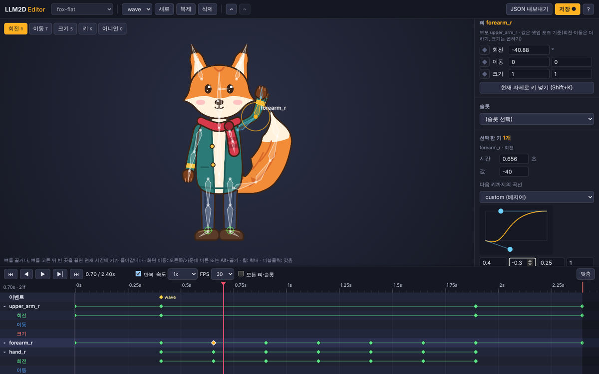

# 타임라인 편집기

Claude가 만든 애니메이션을 사람이 눈으로 보며 다듬는 화면입니다. 캐릭터의 뼈를 직접 잡아
돌리거나 옮기면 현재 시간에 키가 들어가고, 타임라인에서 키를 옮기거나 곡선을 바꿀 수 있습니다.
저장하면 MCP 도구와 같은 `animations.json`에 써서, Claude와 번갈아 작업할 수 있습니다.



## 실행

```bash
pnpm editor
```

http://localhost:5174 를 엽니다. `samples/`와 `out/projects/`의 프로젝트가 위쪽 목록에 나옵니다.
다른 폴더의 프로젝트는 경로를 붙여서 엽니다(폴더 하나, 또는 프로젝트들이 든 폴더).

```bash
pnpm editor out/projects/fox
```

## 화면

| 영역 | 하는 일 |
|---|---|
| 위 막대 | 프로젝트, 애니메이션 선택 · 새로 / 복제 / 삭제 · 실행 취소 / 다시 실행 · JSON 내보내기 · 저장 |
| 가운데 화면 | 현재 시간의 자세. 뼈가 겹쳐 그려집니다(주황 = 선택, 하늘색 = 이 애니메이션에 키가 있음, 초록 원 = IK 목표) |
| 오른쪽 패널 | 애니메이션 길이 · 선택한 뼈의 값과 키 · 슬롯(그림, 투명도, 색) · 선택한 키(시간, 값, 곡선) · 이벤트 |
| 아래 타임라인 | 재생 조작, 시간 눈금, 뼈·슬롯·IK·이벤트별 키 |

## 뼈 움직이기

- 도구: **회전(R)**, **이동(T)**, **크기(S)**. 뼈를 끌면 선택되고 현재 시간에 그 채널의 키가 들어갑니다.
  키 시간은 프레임(기본 30fps)에 맞춰집니다.
- 뼈를 고른 뒤 **빈 곳을 끌어도** 그 뼈가 움직입니다. 길이가 없는 중심 뼈(심볼의 `coin`, `star` 등)는
  이렇게 주변을 돌리며 회전합니다.
- 크기 도구는 기본이 가로세로 같은 비율이고, Shift를 누르고 끌면 뼈 방향 축 하나만 바뀝니다.
- IK로 움직이는 다리는 무릎 뼈 대신 **발 목표 뼈(`foot_l_ik` 등)를 이동 도구로** 옮기세요.
- 오른쪽 패널에 숫자를 직접 넣어도 됩니다. 값은 셋업 자세 기준입니다(회전·이동은 더하기, 크기는 곱하기).
  ◆ 버튼은 그 채널의 키를 넣거나 지웁니다.
- **K**: 선택한 뼈의 현재 도구 채널에 키 · **Shift+K**: 세 채널 모두 키(현재 보이는 자세 그대로).
- 화면 이동은 오른쪽/가운데 버튼이나 Alt+끌기, 확대는 휠, 더블클릭은 화면 맞춤입니다.
- **어니언 스킨(O)**: 0.1초 앞(빨강)과 뒤(초록) 자세를 흐리게 겹쳐 보여 줍니다.

## 타임라인

- 행: 이벤트, 키가 있는 뼈(▸를 누르면 회전·이동·크기 채널), 슬롯, IK. **모든 뼈·슬롯**을 켜면 키 없는
  것도 나옵니다. 선택한 뼈는 항상 보입니다.
- **눈금을 클릭하거나 끌면** 재생 위치가 옮겨집니다(Shift: 프레임에 맞추지 않음).
- **키 클릭**: 선택(Shift: 추가/빼기). 뼈 행의 키를 누르면 그 시간의 모든 채널 키가 함께 선택됩니다.
- **선택한 키 끌기**: 시간 이동(프레임 단위). 옮긴 자리에 키가 있으면 바뀝니다.
- **빈 곳 끌기**: 범위 선택 · **빈 곳 클릭**: 그 시간으로 이동하고 선택 해제.
- **더블클릭**: 그 시간에 키 추가(채널 행은 그 채널, 뼈 행은 현재 도구 채널, 이벤트 행은 이벤트).
- **Delete**: 선택한 키 지우기 · **Ctrl+C / Ctrl+V**: 키 복사 / 재생 위치에 붙이기.
- Ctrl+휠: 확대 · Shift+휠: 시간 방향 스크롤 · 휠: 행 스크롤 · 오른쪽 위 **맞춤(F)**.

## 곡선

키를 고르면 **그 키에서 다음 키까지** 움직이는 모양을 바꿀 수 있습니다. `easeOutBack` 같은 이름 곡선
30여 종 중에서 고르거나, `custom (베지어)`를 골라 손잡이 두 개를 끌어 직접 만듭니다(숫자로도 입력).
여러 키를 고르면 한꺼번에 바뀝니다. `stepped`는 다음 키까지 값이 멈춰 있다가 바뀝니다.

## 슬롯과 이벤트

- 슬롯을 고르고 **그림**(교체 그림 또는 숨김), **투명도**, **색**을 바꾸면 현재 시간에 키가 들어갑니다.
- **이벤트**는 현재 시간에 추가하고, 이름을 고치거나 지웁니다. 게임에서는 `listener.event`로 받습니다
  (예: `land`에 착지 소리).

## 저장

- **저장(Ctrl+S)**은 프로젝트의 `animations.json`에 쓰고 `<이름>.l2d.json`의 애니메이션도 바꿉니다.
  MCP 도구와 같은 방식이며, 저장 전에 검증해서 문제가 있으면 위치와 함께 알려 줍니다.
- `samples/kit`, `bolt`, `gem`처럼 애니메이션이 코드(`animations.ts`, `build.ts`)로 만들어지는 샘플은
  읽기 전용입니다. 다듬은 결과는 **JSON 내보내기**로 받으세요.
- 저장하지 않은 편집이 있으면 프로젝트를 바꿀 수 없고, 창을 닫을 때 확인합니다.
- **실행 취소/다시 실행(Ctrl+Z / Ctrl+Shift+Z)**은 애니메이션 추가·삭제·이름 바꾸기까지 되돌립니다.

## Claude와 번갈아 쓰기

같은 프로젝트 폴더를 Claude(MCP)와 편집기가 함께 씁니다.

1. Claude에게 "여우 wave 애니메이션 만들어줘"라고 하면 MCP 도구가 `animations.json`을 씁니다.
2. 편집기에 열려 있던 프로젝트는 **자동으로 다시 불러와집니다**. 편집기에 저장하지 않은 편집이 있으면
   덮어쓰지 않고 위에 알림을 띄웁니다(다시 불러오기 / 무시).
3. 편집기에서 손목 각도나 타이밍을 다듬고 저장합니다.
4. Claude에게 "편집기에서 고친 wave에 착지 이벤트 넣어줘"라고 하면, Claude는 저장된 파일을 다시 읽고
   이어서 고칩니다(MCP 서버 안내문에 그렇게 하라고 적혀 있습니다).

## 단축키

| 키 | 동작 |
|---|---|
| Space | 재생 / 정지 |
| ← → (Shift: 10프레임) | 프레임 이동 |
| Home / End | 처음 / 끝 |
| R / T / S | 회전 / 이동 / 크기 도구 |
| K / Shift+K | 선택한 뼈: 현재 도구 채널 / 세 채널 키 |
| Delete | 선택한 키 지우기 |
| Ctrl+C / Ctrl+V | 키 복사 / 붙이기 |
| Ctrl+Z / Ctrl+Shift+Z | 실행 취소 / 다시 실행 |
| Ctrl+S | 저장 |
| O | 어니언 스킨 |
| F | 화면·타임라인 맞춤 |
| Esc | 선택 해제 |
| ? | 단축키 보기 |
