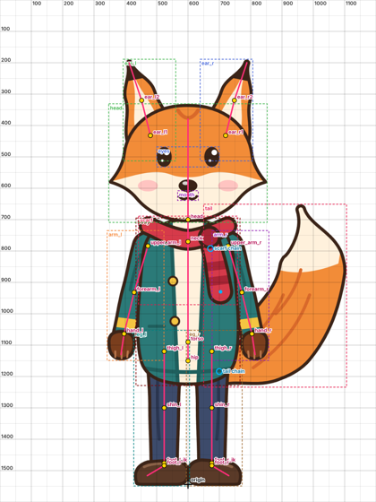
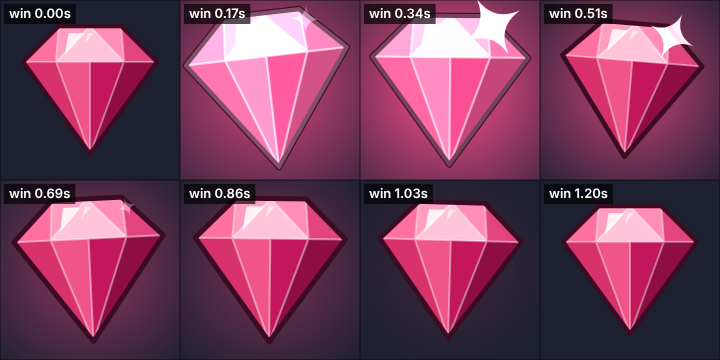
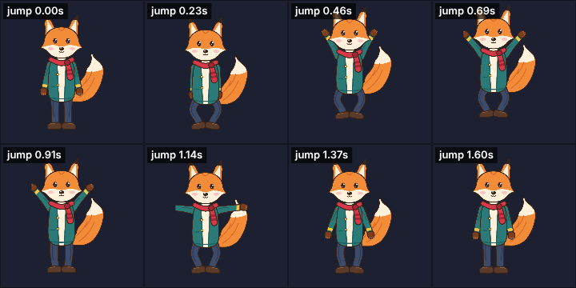

# Claude 연결 (3단계, MCP 서버)

LLM2D MCP 서버를 연결하면 Claude가 직접 레이어 그림을 리깅하고, 애니메이션을 만들고,
게임과 같은 PixiJS 런타임으로 렌더한 결과를 **이미지로 보면서** 고칩니다.

```
"이 PSD로 심볼 리깅하고 land, win 애니메이션 만들어줘"
   │
   ▼  Claude가 MCP 도구를 차례로 호출
create_project → (그림 확인) → set_rig_spec → (뼈 위치 확인) → build_rig → (구부림 테스트 확인)
→ apply_preset / set_animation → (렌더 프레임 확인 후 수정) → validate_project → export_project
```

레이어 없는 그림 한 장(PNG/JPEG/WebP)도 됩니다. `create_project`가 번호 붙은 영역 그림을 주면
Claude가 `split_art`로 부위를 묶어 PSD를 만든 뒤 같은 순서로 진행합니다. 자세한 내용은
[자동 분리](split.md).

## 연결하기

Node 22.18 이상, pnpm, Playwright Chromium이 필요합니다.

```bash
pnpm install
```

```bash
pnpm exec playwright install chromium
```

### Claude Code

저장소 루트의 [`.mcp.json`](../.mcp.json)에 서버가 등록되어 있습니다. 저장소 폴더에서
Claude Code를 실행하면 처음에 이 서버를 쓸지 물어봅니다. 승인하면 `llm2d` 도구가 생깁니다.

```bash
claude
```

연결 상태는 Claude Code에서 `/mcp`로 확인합니다.

### Claude Desktop

`claude_desktop_config.json`에 절대 경로로 추가합니다. `node`가 22.18보다 낮으면 새 버전의
절대 경로를 `command`에 적으세요.

```json
{
  "mcpServers": {
    "llm2d": {
      "command": "node",
      "args": ["/절대/경로/llm2d/packages/mcp/src/server.ts"]
    }
  }
}
```

## 이렇게 요청하세요

- "samples/kit/source/kit.psd로 캐릭터 프로젝트를 out/fox에 만들고 리깅해줘. 꼬리와 스카프는
  체인으로, 다리는 IK로."
- "이 그림 한 장(fox.jpg)을 부위별로 나눠서 캐릭터로 만들어줘. 귀, 팔, 다리, 꼬리가 움직이게."
- "fox에 idle 만들어줘. 숨쉬기, 꼬리 흔들기, 1.6초에 눈 깜빡임."
- "이 심볼 PSD로 land, win, idle 만들어줘. 빛과 반짝임 레이어도 써서."
- "win이 너무 약해. 첫 박자를 더 크게 하고 반짝임을 늦게."
- "완성되면 검증하고 ../my-game/static/assets로 내보내줘."

## 도구

| 도구 | 하는 일 |
|---|---|
| `create_project` | PSD를 프로젝트 폴더로 복사하고 시작용 `rig.json`(원점·배율 추정)을 만듦. 레이어 목록과 확인 이미지 반환. 그림 한 장이면 배경을 지우고 번호 붙은 영역 그림과 영역 표 반환 |
| `segment_art` | 그림 한 장을 다른 설정(영역 세밀도, 배경 처리)으로 다시 영역 나누기 |
| `split_art` | 영역을 부위로 묶어 레이어 PSD를 만듦. 외곽선은 앞 부위로, 가려진 곳은 자동 복원. 레이어 확인 그림(자홍색 = 복원한 곳)과 레이어 상자 그림 반환 |
| `inspect_art` | 레이어 목록 + 격자·레이어 상자·현재 뼈가 그려진 이미지 |
| `get_rig_spec` / `set_rig_spec` | 리그 명세 읽기/쓰기. 쓰면 뼈를 그림 위에 겹친 이미지를 돌려줘서 관절 위치를 확인 |
| `build_rig` | 메시·체인·가중치 자동 생성, `.l2d.json` 저장, 구부림 테스트 결과와 자세 이미지 |
| `bend_test` | 구부림 테스트 다시 실행(극단 자세 포함 가능) |
| `describe_skeleton` | 뼈(부모, 위치, 각도, 길이), 슬롯과 첨부물, IK, 애니메이션 목록 |
| `list_presets` | 모션 프리셋 목록과 매개변수 |
| `apply_preset` | 프리셋으로 키 생성. `merge`로 여러 프리셋을 한 애니메이션에 합치기, `start`로 시작 시간 지정. 미리보기 반환 |
| `set_animation` / `get_animation` / `delete_animation` | 애니메이션 JSON 직접 편집. 오류는 고칠 키 위치를 정확히 알려 줌 |
| `render_animation` | 애니메이션 프레임 모음 이미지(디버그 표시 가능) |
| `render_frame` | 특정 시간의 큰 프레임 한 장 또는 셋업 포즈 |
| `validate_project` | 파일·이미지 검증 + 구부림 테스트 요약 |
| `export_project` | 게임용으로 내보내기: 줄인 `.l2d.json` + 아틀라스 페이지(`scale`로 모바일용 축소) |

## 모션 프리셋

| 분류 | 프리셋 | 내용 |
|---|---|---|
| 심볼 | `symbol_idle` | 둥실 떠 있기 + 숨쉬듯 크기 변화 (반복) |
| 심볼 | `symbol_land` | 릴 정지: 떨어져서 찌그러졌다가 탄성 있게 자리 잡기, 번쩍임. 이벤트 `land` |
| 심볼 | `symbol_win` | 당첨: 크게 튀는 박동 + 흔들림, 빛·번쩍임·반짝임 (반복) |
| 심볼 | `anticipation` | 기대감: 커진 채로 떨기 (반복) |
| 심볼 | `big_win_title` | BIG WIN 타이틀: 크게 내리꽂히고 반동 후 박동. 이벤트 `slam` |
| 공통 | `pop_in` / `pop_out` | 나타나기 / 사라지기 |
| 공통 | `spin`, `fade`, `shake` | 회전, 투명도, 감쇠하는 흔들림 |
| 캐릭터 | `sway` | 꼬리·귀·머리카락·스카프의 2차 동작. 뿌리에서 끝으로 전달 (반복) |
| 캐릭터 | `breathe` | 숨쉬기 상하 움직임 (IK 다리면 무릎이 살짝 굽음) |
| 캐릭터 | `blink`, `talk`, `nod` | 눈 깜빡임, 입 모양 교체 + 고개, 끄덕임 |
| 캐릭터 | `wave` | 팔 들어 손 흔들기. 바깥 방향은 팔 각도로 자동 판단 |
| 캐릭터 | `jump` | 웅크림 → 점프(IK 발이 같은 타이밍으로 따라감) → 착지. 이벤트 `jump`, `land` |

## 프로젝트 폴더 구조

```
out/fox/
  source/kit.psd      원본 그림 (create_project가 복사; 그림 한 장이면 split_art가 만듦)
  split.json          그림 한 장에서 시작한 경우: 원본 그림 경로, 배경·세밀도 설정, 부위 묶음
  rig.json            리그 명세 (art 경로 포함)
  animations.json     애니메이션 원본
  fox.l2d.json        빌드된 스켈레톤 (애니메이션 편집 시 함께 갱신)
  images/             잘라낸 레이어 이미지
```

애니메이션을 고칠 때는 메시를 다시 만들지 않고 `.l2d.json`의 애니메이션만 바꿉니다.
`build_rig`를 다시 하면 `animations.json`이 포함됩니다.

## 실제 실행 예

아래 이미지는 MCP 도구 호출 결과로 받은 그림입니다(`scripts/mcp-call.ts`로 실행).

**`set_rig_spec` 응답:** 그림 위에 뼈(분홍 선, 노란 관절), 체인 시작점(파란 원), 원점이 그려집니다.



**`apply_preset` + `render_animation`:** 루비 심볼의 `symbol_win`(빛·번쩍임·반짝임 포함)



**`apply_preset`:** 여우의 `jump`(IK 발, 팔 올리기 포함)



## 직접 도구 호출해 보기

Claude 없이도 터미널에서 같은 도구를 부를 수 있습니다. 이미지는 `out/mcp/`에 저장됩니다.

```bash
pnpm mcp:call list
```

```bash
pnpm mcp:call create_project '{"dir":"out/projects/ruby","art":"samples/gem/source/gem.psd","kind":"symbol","name":"ruby"}'
```

```bash
pnpm mcp:call render_animation '{"dir":"out/projects/ruby","name":"win"}'
```

여러 호출은 `[{ "tool": ..., "args": ... }]` 형태의 JSON 파일로 `pnpm mcp:call batch calls.json`.

## 문제 해결

| 증상 | 해결 |
|---|---|
| `Executable doesn't exist ... chromium` | `pnpm exec playwright install chromium` |
| 서버가 시작되지 않음 / 문법 오류 | Node 22.18 이상인지 확인(`node -v`). TypeScript를 바로 실행합니다 |
| 첫 렌더가 느림 | 첫 호출에서 브라우저와 뷰어를 띄웁니다(몇 초). 이후 호출은 재사용 |
