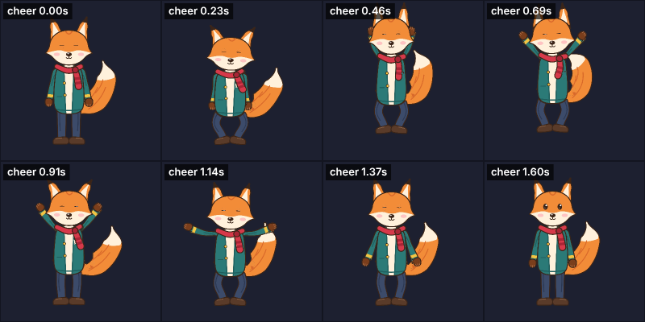
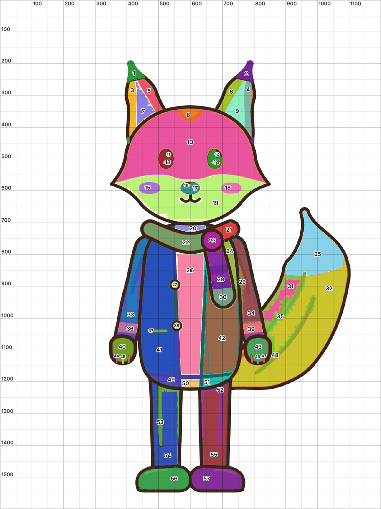
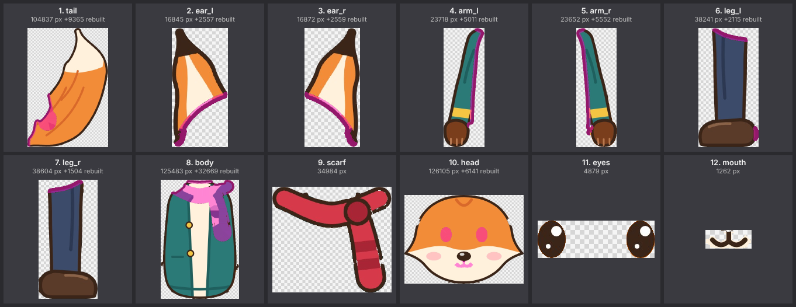
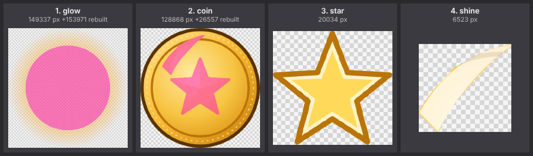

# 평면 그림 한 장에서 시작하기 (자동 분리)

레이어가 없는 그림 한 장(PNG, JPEG, WebP)을 부위별 레이어로 나눠 PSD로 만듭니다. 그다음은
[자동 리깅](rigging.md)과 똑같습니다. 이미지 생성 AI로 만든 그림이나 합쳐진 채로 받은 그림을
바로 움직일 수 있습니다.

```
그림 한 장 ──► 색 영역 번호 매기기 ──► 번호를 부위로 묶기 ──► 레이어 PSD ──► 리깅 ──► 애니메이션
               (자동)                   (Claude/사람)           가려진 곳 자동 복원
```

예제: [`samples/kit-flat`](../samples/kit-flat). 여우 Kit를 흰 배경 JPEG 한 장으로 합친 그림
(`source/kit-flat.jpg`)에서 다시 레이어를 만들고, Kit와 같은 뼈 배치로 리깅했습니다.

| 입력 (JPEG 한 장) | 자동 분리 후 리깅한 결과 |
|---|---|
|  |  |

## 1. 영역 보기

```bash
pnpm split regions samples/kit-flat/source/kit-flat.jpg
```

`out/split/kit-flat-regions.png`에 번호가 붙은 영역 그림과 픽셀 격자가 나오고, 터미널에는 영역
표(번호, 평균 색, 크기, 영역 안의 한 점, 이웃 영역)가 나옵니다.



자동으로 하는 일:

- **배경 제거:** 테두리 색이 고르면(흰 배경 등) 그 색을 투명하게 합니다. 가장자리는 반투명으로
  남기고 배경색을 빼서 밝은 테두리가 남지 않게 합니다. 다리 사이처럼 그림에 둘러싸인 큰 배경도
  지웁니다(그림 크기의 1% 이상). 투명 PNG는 그대로 씁니다.
- **영역 나누기:** 색이 비슷하고 붙어 있는 픽셀을 한 영역으로 묶습니다. JPEG 잡음을 줄이려고
  먼저 중간값 필터를 쓰고, 압축으로 번지기 쉬운 색조보다 밝기 차이를 더 중요하게 봅니다.
- **외곽선 찾기:** 주변보다 어둡고 가는 획은 외곽선으로 따로 둡니다. 번호가 붙지 않고, 나눌 때
  앞쪽 부위로 갑니다. 같은 색이라도 눈동자처럼 두꺼운 덩어리는 영역으로 남습니다.
- **빛 번짐, 그림자:** 넓게 퍼진 반투명한 면(심볼 뒤의 빛 번짐, 부드러운 그림자, 연기)은 따로 한
  영역이 됩니다. 레이어로 나누면 빛만 깜빡이거나 커지게 할 수 있습니다.

## 2. 부위로 묶기 (`split.json`)

부위를 **뒤에서 앞 순서로**(PSD 레이어 아래에서 위) 적고, 각 부위에 영역을 넣습니다.

```json
{
  "background": "auto",
  "parts": [
    { "name": "tail", "regions": [25, 31, 32, 35, 48] },
    { "name": "arm_l", "regions": [33, 36, 40] },
    { "name": "body", "regions": [20, 24, 26, 41, 42, 49, 50, 51] },
    { "name": "head", "regions": [8, 10, 15, 17, 18, 19] },
    { "name": "eyes", "regions": [11, 12, 13, 14] },
    { "name": "mouth", "strokes": [[560, 612], [640, 612], [640, 646], [560, 646]] }
  ]
}
```

| 항목 | 뜻 |
|---|---|
| `regions` | 영역 번호, 또는 영역 안의 점 `[x, y]`(그림 픽셀). 저장해 둘 파일에는 점이 좋습니다. 번호는 설정이 바뀌면 달라집니다 |
| `polygon` | 다각형 안의 모든 픽셀. 한 영역이 두 부위에 걸쳐 있을 때 자르는 용도 |
| `strokes` | 다각형 안에서 **둘레 색을 뺀 나머지**. 얼굴 위에 그린 입, 눈썹, 수염처럼 면 위에 그린 선 |
| `rest` | 아무 부위에도 없는 영역을 모두 가져갈 부위 하나 |
| `remove` | 지울 영역(그림 안에 남은 배경 등) |
| `fill` / `overlap` | 가려진 곳 복원 반지름 / 앞 부위 밑으로 들어가는 폭(px). 부위마다 따로 줄 수도 있습니다 |
| `background`, `detail` | 배경 처리(`auto`, `none`, `#rrggbb`), 영역 세밀도(2 = 더 잘게, 0.5 = 더 크게) |

작은 영역(단추, 눈 하이라이트, 줄무늬, 손가락 선)은 그것을 둘러싼 부위로 자동으로 들어갑니다.
어느 부위에도 들어가지 못한 영역이 있으면 번호와 함께 알려 줍니다.

```bash
pnpm split build samples/kit-flat/source/kit-flat.jpg --spec samples/kit-flat/split.json --psd samples/kit-flat/source/kit-flat.psd
```

PSD와 함께 레이어 확인 그림(`out/split/kit-flat-split.png`)이 나옵니다. **자홍색은 앞 부위에
가려져 있던 곳을 새로 채운 부분**입니다.



## 3. 가려진 곳 복원

그림 한 장에는 팔 뒤의 몸통, 머리 뒤의 귀 뿌리가 없습니다. 그대로 자르면 팔을 들 때 구멍이
보입니다. 그래서 각 부위를 앞 부위 밑으로 이어서 채웁니다.

- **외곽선은 앞 부위 것:** 팔과 몸통 사이의 선은 앞에 있는 부위가 가져갑니다. 선 끝의 둥근
  마무리와 선 바깥쪽의 흐린 가장자리 픽셀까지 가져가서, 앞 부위가 움직여도 뒤 부위에 선 자국이
  남지 않습니다. 뒤 부위는 그 자리에 자기 외곽선을 새로 그려 받습니다(`overlap`, 기본은 선
  굵기보다 조금 넓게).
- **자기 외곽선이 없는 부위**(반짝임, 빛 번짐)는 선을 가져가지 않습니다. 반짝임 옆을 지나는
  코인 테두리 선은 코인 것입니다.
- **오목하게 파인 곳 메우기:** 앞 부위 때문에 파인 모양을 원판으로 닫아(`fill`, 기본은 그림
  크기의 10%) 원래 모양을 짐작합니다. 몸통을 가로지른 팔 밑, 꼬리를 덮은 손 밑이 여기에 해당합니다.
- **완전히 가려진 구멍:** 앞 부위들이 통째로 덮은 구멍(코인 뒤의 빛 번짐, 방패 뒤의 몸통)은
  크기와 상관없이 채웁니다.
- **반투명 부위:** 빛 번짐처럼 대부분 반투명한 부위는 가까운 픽셀의 투명도 그대로, 외곽선 없이
  이어 채웁니다.
- **색:** 둘레의 넓은 색 면에서 부드럽게 이어 칠합니다. 앞 부위 양쪽의 색이 비슷하면(그러데이션이 팔에
  가려 둘로 나뉜 경우) 그러데이션이 그대로 이어지고, 색이 다른 면 사이는 경계를 또렷하게 둡니다(만화풍의
  단색 면). 가는 주름선이나 줄무늬는 번지지 않게 뺍니다.
- **새 가장자리:** 원래 그림에 외곽선이 있으면 새로 생긴 가장자리에도 이어 그립니다.
- **채우기는 앞 부위 밑에만** 하므로, 레이어를 다시 겹치면 입력 그림과 **픽셀 단위로 똑같습니다**
  (매번 검사해서 알려 줍니다).

## 심볼 예: 빛 번짐이 있는 코인

슬롯 심볼은 보통 빛 번짐 + 본체 + 무늬 + 반짝임으로 되어 있습니다. 코인 샘플을 합친 그림
(`samples/coin/source/coin-preview.png`)을 나눠 보면:

```bash
pnpm split regions samples/coin/source/coin-preview.png
```

```json
{
  "parts": [
    { "name": "glow", "regions": [[320, 50]] },
    { "name": "coin", "regions": [[127, 309], [506, 271], [358, 131], [392, 225]] },
    { "name": "star", "regions": [[319, 323]] },
    { "name": "shine", "regions": [[287, 152], [212, 228]] }
  ]
}
```



빛 번짐은 코인 뒤까지 반투명하게 채워지고(코인이 뒤집히거나 작아져도 빈 곳이 없음), 코인은 별과
반짝임 밑이 채워지고, 별은 뾰족한 끝의 외곽선까지 온전히 나옵니다. 원래 PSD에서 `add`(더하기)로
겹쳐 있던 빛도 나눈 뒤에는 보통 레이어입니다. 게임에서 더하기로 그리려면 슬롯에 `blend: "add"`를
주세요([형식](format.md)).

## 4. 리깅

나온 PSD는 그리는 사람이 준 PSD와 똑같이 씁니다. 레이어 이름이 부위 이름입니다.

```bash
pnpm rig build samples/kit-flat/source/kit-flat.psd --spec samples/kit-flat/rig.json --animations samples/kit-flat/animations.ts --out samples/kit-flat
```

`pnpm samples kit-flat`은 분리와 리깅을 한 번에 합니다.

## Claude에게 맡기기 (MCP)

[`docs/mcp.md`](mcp.md)의 MCP 서버를 연결하고 이렇게 요청하면 됩니다.

> "이 그림(fox.jpg)으로 캐릭터 만들어줘. 꼬리는 체인으로, 손 흔들기와 점프 넣어서."

Claude가 하는 일:

1. `create_project`에 그림 파일을 주면 배경을 지우고 번호 붙은 영역 그림과 표를 돌려줍니다.
2. 그림을 보고 `split_art`로 부위를 묶습니다. 레이어 확인 그림과 레이어 상자가 그려진 그림을
   받아 잘못 묶인 곳을 고칩니다.
3. 그다음은 PSD로 시작할 때와 같습니다: `set_rig_spec` → `build_rig` → 애니메이션.

영역이 두 부위에 걸쳐 나오면 `segment_art`로 세밀도(`detail`)를 높이거나, `polygon`으로 자릅니다.

## 결과 비교

같은 여우를 원래 레이어(왼쪽)와 JPEG 한 장에서 분리한 레이어(오른쪽)로 리깅해 같은 동작의 같은
시점을 그렸습니다.


- 원래 레이어와 겹치는 정도(IoU, 보이는 픽셀 기준): JPEG 입력에서 꼬리·귀·팔·다리·몸통·스카프·
  머리·눈 모두 0.97 이상. 가는 선인 입은 가장자리 픽셀 비중이 커서 0.71입니다. 선 바깥쪽의 흐린
  픽셀(선이 15% 이상 섞인 것)은 일부러 앞 부위에 주므로, 절반 투명도를 기준으로 재는 IoU보다
  움직일 때의 모양(뒤 부위에 선 자국이 남지 않음)을 우선합니다. 테스트
  (`packages/rig/test/split.test.ts`)는 주요 부위 0.93 이상을 확인합니다.
- 다시 겹친 레이어와 입력 그림의 차이: 0
- 구부림 테스트: 오류 0개, 경고 12개(원래 레이어 버전은 경고 17개)
- 시간(1200x1600): 배경 제거 약 1초, 영역 나누기 약 5초, 레이어 만들기 약 8초

## 한계와 요령

- **눈 감기, 입 벌리기 같은 교체 그림은 없습니다.** 한 장에는 한 표정만 있으므로 눈은 눈 뼈의
  세로 크기로 감기고(`samples/kit-flat/animations.ts`), 다른 표정이 필요하면 따로 그려서
  숨긴 레이어로 넣으세요.
- **가려진 곳은 짐작입니다.** 오목한 곳은 메워지지만, 앞 부위가 뒤 부위의 끝을 통째로 덮은
  경우(예: 원판 오른쪽 끝이 막대 뒤에 숨은 경우)에는 `overlap`만큼만 이어집니다. 크게 움직일
  부위는 레이어 확인 그림에서 자홍색 영역을 보고 필요하면 `fill`을 키우세요. 위 비교 그림의
  꼬리 왼쪽 끝처럼 가장자리 모양이 조금 어색할 수 있습니다.
- **무늬와 선은 다시 그리지 않습니다.** 가려진 곳의 색은 둘레에서 부드럽게 이어지지만, 무늬나 가려진
  경계선(예: 스카프 밑 재킷 단추선, 반짝임 밑을 지나던 코인 안쪽 테두리)은 다시 그려지지 않습니다.
- **외곽선이 뚜렷한 만화풍이 가장 잘 됩니다.** 외곽선 없이 그러데이션이 많은 그림은 영역이
  잘게 나오므로 `detail`을 0.5로 낮추거나 `polygon`으로 부위를 정하세요.
- **JPEG 압축이 심하면** 색이 외곽선 너머로 번져 영역이 두 부위에 걸칠 수 있습니다. 영역 그림에서
  확인하고 `polygon`으로 자르세요. 가능하면 PNG를 쓰세요.
