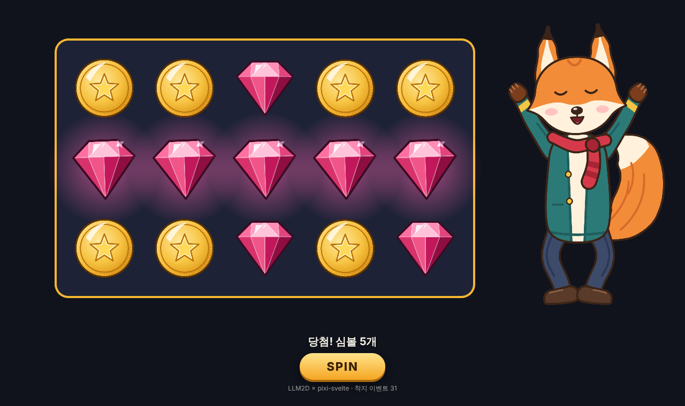
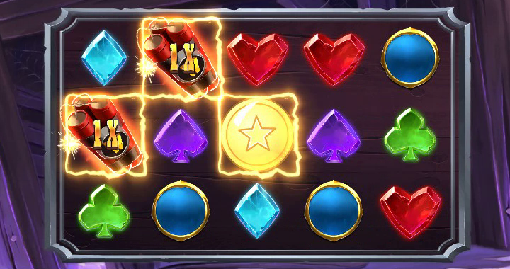

# Stake 게임에 넣기 (4단계)

LLM2D 스켈레톤을 Stake Engine 웹 SDK 게임(PixiJS 8 + Svelte 5 + `pixi-svelte`)에서 Spine처럼
씁니다. 예제 앱: [`apps/reel-demo`](../apps/reel-demo) (5x3 보드, 착지·당첨 애니메이션, 당첨에
반응하는 여우 호스트).



실제 Stake 게임 저장소에 붙인 예: [`examples/stake-lines`](../examples/stake-lines). 공식 web-sdk의
샘플 게임 `lines`에서 H1 심볼을 LLM2D 동전으로 바꾸고, Storybook에서 스핀·착지·당첨까지 확인했습니다.
`pnpm stake:lines apply ../web-sdk` 한 줄로 적용됩니다.



## 1. 게임용으로 내보내기

이미지를 아틀라스 페이지로 묶고 JSON을 줄인 파일을 게임의 static 폴더에 씁니다.

```bash
pnpm export samples/kit/kit.l2d.json samples/coin/coin.l2d.json --out ../my-game/static/assets/llm2d
```

모바일용 절반 해상도 세트도 만들 수 있습니다(크기는 그대로, 텍스처만 축소).

```bash
pnpm export samples/kit/kit.l2d.json --out ../my-game/static/assets/llm2d-half --scale 0.5
```

Claude에게 맡길 때는 MCP 도구 `export_project`가 같은 일을 합니다(`atlas`, `scale`, `max_size` 옵션).

결과물: `<이름>/<이름>.l2d.json` + `<이름>.png`(아틀라스 페이지, 크면 `-2.png` 등이 추가됨).
원본과 아틀라스 버전을 같은 프레임으로 렌더해 비교하면 픽셀 차이가 최대 1입니다.

## 2. 패키지 설치

레지스트리 없이 설치할 수 있도록 tgz 파일을 만듭니다.

```bash
pnpm pack:lib
```

`out/packages/`에 `llm2d-core`, `llm2d-pixi`, `llm2d-svelte` tgz가 생깁니다. 게임 저장소로 복사한 뒤
게임 앱의 `package.json`에 추가합니다. `@llm2d/svelte`가 나머지 둘에 의존하므로 `pnpm.overrides`로
같은 tgz를 가리키게 합니다(Stake 모노레포라면 루트 `package.json`).

```json
{
  "dependencies": {
    "@llm2d/svelte": "file:./vendor/llm2d-svelte-0.1.0.tgz"
  },
  "pnpm": {
    "overrides": {
      "@llm2d/core": "file:./vendor/llm2d-core-0.1.0.tgz",
      "@llm2d/pixi": "file:./vendor/llm2d-pixi-0.1.0.tgz"
    }
  }
}
```

```bash
pnpm install
```

패키지는 JS(`dist/`)와 타입 선언을 담고 있어서 `svelte-check`와 Vite 빌드가 그대로 됩니다.
작업 공간 밖의 별도 앱에 이 tgz를 설치해 `svelte-check`, Vite 6.2 빌드, 브라우저 실행까지 확인했습니다.

## 3. 로더 등록과 에셋 선언

`pixi-svelte`의 `AssetsLoader`는 `sprite` 종류 에셋을 `PIXI.Assets.load`로 그대로 불러옵니다.
`registerLlm2dLoader()`를 먼저 호출하면 `.l2d.json`이 스켈레톤으로 로드됩니다. pixi-svelte는
수정할 필요가 없습니다.

```ts
// 게임 진입점 (앱이 마운트되기 전)
import { registerLlm2dLoader } from '@llm2d/svelte';
registerLlm2dLoader();
```

```ts
// game/assets.ts — 기존 Spine 에셋 옆에 그대로 추가
export default {
  // ...
  fox: { type: 'sprite', src: new URL('../../assets/llm2d/kit/kit.l2d.json', import.meta.url).href },
  coin: { type: 'sprite', src: new URL('../../assets/llm2d/coin/coin.l2d.json', import.meta.url).href },
};
```

## 4. 컴포넌트

`SpineProvider` / `SpineTrack` / `SpineSlot`과 같은 자리에 씁니다.

```svelte
<script lang="ts">
  import { Llm2dProvider, Llm2dTrack, Llm2dBone } from '@llm2d/svelte';
  import { Sprite } from 'pixi-svelte';
</script>

<!-- 심볼: 중심 기준, 셀 크기에 맞춤 -->
<Llm2dProvider key="coin" x={cellX} y={cellY} anchor={0.5} width={SYMBOL_SIZE}>
  <Llm2dTrack trackIndex={0} animationName={win ? 'win' : 'idle'} loop mix={0.1} />
</Llm2dProvider>

<!-- 호스트: 원점(발)이 (x, y)에 오고 높이 520에 맞춤 -->
<Llm2dProvider key="fox" x={1080} y={600} height={520}>
  <Llm2dTrack
    trackIndex={0}
    animationName={hostAnimation}
    loop={hostAnimation === 'idle'}
    listener={{
      complete: (e) => e.animation.name === 'cheer' && (hostAnimation = 'idle'),
      event: (_e, ev) => ev.name === 'land' && playSound('thud'),
    }}
  />
  <Llm2dTrack trackIndex={1} animationName="blink" />
  <!-- 뼈를 따라다니는 오브젝트 (예: 손에 든 동전) -->
  <Llm2dBone boneName="hand_r">
    <Sprite key="coinIcon" anchor={0.5} />
  </Llm2dBone>
</Llm2dProvider>
```

| 컴포넌트 | 주요 props |
|---|---|
| `Llm2dProvider` | `key`(로드된 에셋 키) 또는 `asset`, `x`, `y`, `anchor`(경계 상자 기준, 0.5 = 중심, 생략 시 스켈레톤 원점), `width`/`height`(맞춤), `scale`, `tint`, `alpha`, `visible`, `debug`, `onactor` |
| `Llm2dTrack` | `trackIndex`, `animationName`, `loop`, `mix`(전환 시간), `mixOut`(제거 시 페이드), `timeScale`, `alpha`, `listener` |
| `Llm2dBone` | `boneName`; 자식이 뼈의 위치·회전·크기를 따라감 |

`animationName`을 바꾸면 이전 애니메이션에서 부드럽게 넘어갑니다. 컴포넌트를 제거하면 그 트랙이
`mixOut` 동안 사라집니다. `trackIndex`를 바꾸면 이전 트랙은 같은 방식으로 사라집니다. `listener`는 Spine과
같은 모양(`start`, `complete`, `end`, `interrupt`, `event`)입니다.

### 런타임 동작

- **listener는 상태 변경이 끝난 뒤에 불립니다**(Spine의 이벤트 큐와 같음). `end`나 `complete` 안에서
  `setAnimation`, `addAnimation`, `clearTrack`을 불러도 됩니다. 엔트리마다 `end`는 한 번만 옵니다.
- **반복 중에 `loop`를 끄면** 지금 바퀴를 끝까지 재생하고 `complete`를 한 번 보낸 뒤 마지막 프레임에
  멈춥니다(Spine은 바로 마지막 프레임으로 건너뜁니다). `Llm2dTrack`의 `loop`를 바꿀 때도 같습니다.
- 반복 애니메이션 뒤에 `addAnimation(트랙, 이름)`(delay 0 이하)을 하면 **지금 바퀴가 끝날 때** 넘어갑니다.
- 애니메이션 끝 시각(`duration`)에 둔 이벤트는 반복할 때마다 한 번씩 옵니다. 길이 0인 애니메이션의
  이벤트도 옵니다. 다른 애니메이션으로 넘어가며 **사라지는 중인 애니메이션의 이벤트는 오지 않습니다**
  (Spine과 같음; 엔트리의 `eventThreshold`를 0~1로 주면 전환이 그만큼 진행될 때까지는 옵니다).
- 대기열에 있던 엔트리가 `setAnimation`/`clearTrack`으로 버려지면 그 엔트리에 `end`가 옵니다.
- `timeScale`은 0 이상입니다(음수는 0). 크로스페이드는 엔트리 속도와 상관없이 실제 시간으로 진행합니다.
- `autoUpdate`(기본)일 때 자세는 **그리기 직전에** 맞춥니다. 마운트한 첫 프레임부터 애니메이션 자세가
  보입니다.
- `actor.destroy()`는 메시와 GPU 버퍼를 지우고 **텍스처는 지우지 않습니다**(같은 에셋을 쓰는 다른 액터가
  있으므로). 텍스처는 에셋을 내릴 때(`Assets.unload`) 지웁니다.
- **클리핑**(반짝임을 심볼 모양으로 자르기)은 Pixi 마스크로 그립니다. 클리핑이 켜진 동안 그 심볼은 그리기
  호출이 몇 번 늘어납니다(보드의 심볼 15개 정도는 문제없음). 안 쓰는 동안은 클리핑 슬롯의 첨부물을 숨기면
  마스크도 꺼집니다.

## 5. 심볼 상태와 연결하기 (web-sdk 샘플 게임)

web-sdk 샘플 게임은 심볼마다 `static`, `spin`, `land`, `win`, `postWinStatic` 상태를 쓰고,
`SYMBOL_INFO_MAP`에서 상태별로 그릴 것(`sprite` 또는 `spine`)을 정합니다. LLM2D 심볼은 `type: 'llm2d'`를
하나 더 두고 같은 자리에서 고릅니다.

- `static`, `spin`, `postWinStatic` → `idle`(반복)
- `land`, `win` → 한 번 재생. `Llm2dTrack`의 `listener.complete`로 게임의 `oncomplete`를 불러야
  `land` → `static`, `win` → `postWinStatic`으로 넘어갑니다.
- `land`/`win` 중에는 Spine 심볼처럼 마스크 밖 보드에 그려야 커진 심볼이 잘리지 않습니다(`ReelSymbol`의 `animating`).
- 터보 속도는 `timeScale={stateBetDerived.timeScale()}`.

전체 코드는 [`examples/stake-lines/lines.patch`](../examples/stake-lines/lines.patch)의 `SymbolLlm2d.svelte`를 보세요.

## 6. 애니메이션 이름 약속

| 대상 | 이름 | 반복 |
|---|---|---|
| 심볼 | `idle` | 예 |
| 심볼 | `land` (이벤트 `land`) | 아니요 |
| 심볼 | `win` | 예 |
| 심볼 | `anticipation` | 예 |
| 캐릭터 | `idle`, `blink`(트랙 1), `talk`, `wave`, `cheer`/`jump` (이벤트 `jump`, `land`) | 상황별 |
| 타이틀 | `big_win_title` 프리셋 결과 (이벤트 `slam`) | 아니요 |

## Spine 대신 쓸 때 다른 점

- 에셋 선언: `type: 'spine'` + `{ atlas, skeleton }` 대신 `type: 'sprite'` + `.l2d.json` 하나
- 컴포넌트 이름: `SpineProvider` → `Llm2dProvider`, `SpineTrack` → `Llm2dTrack`, `SpineSlot`/`SpineBone` → `Llm2dBone`
- `anchor`는 스켈레톤 경계 상자 기준입니다. 생략하면 스켈레톤 원점(캐릭터는 발 사이)이 `(x, y)`에 옵니다.
- 런타임 API(`actor.state.setAnimation(0, 'win', true)`, `addAnimation`, `setEmptyAnimation`)는 spine-ts와 같습니다.
