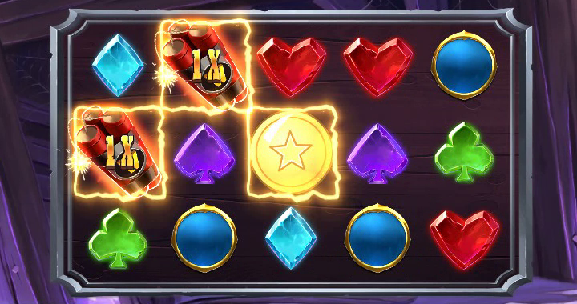
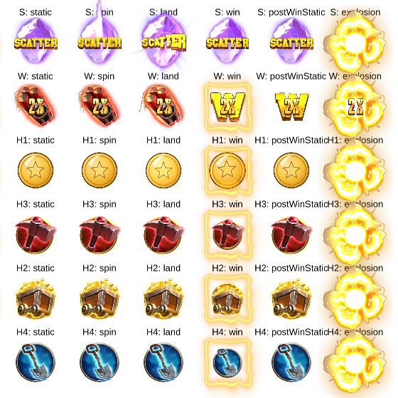

# Stake web-sdk `lines` 게임에 붙이기

Stake Engine 공식 웹 SDK([StakeEngine/web-sdk](https://github.com/StakeEngine/web-sdk))의 샘플 게임
`lines`에서 H1 심볼(원래는 스프라이트 + Spine)을 LLM2D 동전([`samples/coin`](../../samples/coin))으로
바꿉니다. 게임 코드와 `pixi-svelte`는 그대로 두고, 심볼 하나를 그리는 부분만 갈아 끼웁니다.



*`MODE_BASE/book` 스토리에서 book 25를 실행한 화면. 9번 라인 W–W–H1 당첨에서 LLM2D 동전이 커지며 빛나고 당첨 프레임이 붙습니다.*


*같은 판에서 동전만 잘라 본 순서: 릴 정지 → `land`(납작해졌다가 번쩍임) → `win`(커짐, 빛, 별 회전) → `postWinStatic`(다시 `idle`).*

## 1. 적용

web-sdk를 받아 둡니다(LLM2D 저장소 옆 폴더 예시).

```bash
git clone https://github.com/StakeEngine/web-sdk ../web-sdk
```

LLM2D 저장소에서 한 번에 적용합니다.

```bash
pnpm stake:lines apply ../web-sdk
```

하는 일:

1. `pnpm pack:lib`로 `@llm2d/core`, `@llm2d/pixi`, `@llm2d/svelte` tgz를 만들어 `web-sdk/vendor/`에 복사
2. 동전을 `apps/lines/static/assets/llm2d/coin/`으로 내보내기(아틀라스 560x468, 텍스처 절반 크기, 154 KB)
3. [`lines.patch`](lines.patch) 적용(코드 7개 파일)
4. web-sdk에서 `pnpm install`

다시 실행해도 됩니다(이미 적용된 패치는 건너뜀). 패치는 web-sdk 커밋 `1843d60`(2025-11-28) 기준입니다.
더 새 버전에서 패치가 안 맞으면 아래 [직접 적용하기](#직접-적용하기)를 따르세요.

## 2. 실행

```bash
cd ../web-sdk
```

```bash
pnpm run storybook --filter=lines
```

http://localhost:6001 에서:

- `Components/<Symbol>` → `symbols`: 모든 심볼의 모든 상태. `H1` 줄이 LLM2D 동전입니다.
- `MODE_BASE/book` → `random` → 왼쪽 위 **Action**: 실제 게임 한 판(스핀, 착지, 당첨).



Storybook이 처음 실행할 때 `JavaScript heap out of memory`로 멈추면 메모리를 늘려 다시 실행하세요.
LLM2D와 상관없이 원본 web-sdk에서도 같은 일이 생깁니다.

```bash
NODE_OPTIONS=--max-old-space-size=8192 pnpm run storybook --filter=lines
```

## 3. 자동 확인(선택)

Storybook을 켜 둔 채로 LLM2D 저장소에서 실행하면 화면을 저장합니다.

```bash
pnpm stake:lines capture --out out/stake-lines
```

- `symbols.png`: 심볼 상태표
- `game-00.png` …: book 25(H1 당첨이 있는 판)를 실행하며 0.4초마다 찍은 화면

동전 스켈레톤이 로드되지 않거나 페이지 오류가 나면 실패(종료 코드 1)합니다. 옵션: `--url`, `--book`,
`--every <ms>`, `--shots <개수>`.

## 바뀌는 파일

| 파일 | 내용 |
|---|---|
| `package.json` (루트) | `pnpm.overrides`로 `@llm2d/core`, `@llm2d/pixi`를 `vendor/` tgz에 연결 |
| `apps/lines/package.json` | `@llm2d/svelte` 의존성 추가 |
| `apps/lines/src/game/assets.ts` | `registerLlm2dLoader()` 호출, `llm2dCoin` 에셋(`type: 'sprite'` + `.l2d.json`) |
| `apps/lines/src/game/constants.ts` | H1 상태 → LLM2D 애니메이션 (`static`, `spin`, `postWinStatic` → `idle`, `land` → `land`, `win` → `win`, `explosion`은 기존 Spine) |
| `apps/lines/src/components/SymbolLlm2d.svelte` | 새 컴포넌트: `Llm2dProvider` + `Llm2dTrack` + 당첨 프레임 |
| `apps/lines/src/components/Symbol.svelte` | `type: 'llm2d'`이면 `SymbolLlm2d` 사용 |
| `apps/lines/src/components/ReelSymbol.svelte` | `land`/`win` 중인 LLM2D 심볼도 `animating`으로 처리 |
| `vendor/`, `apps/lines/static/assets/llm2d/` | `apply`가 만드는 파일(패치에는 없음) |

## 게임 흐름에 맞춘 점

- **상태 전환**: `land`, `win`은 한 번 재생하고 끝나면 `oncomplete`를 부릅니다. `ReelSymbol`이 이걸 받아
  `land` → `static`, `win` → `postWinStatic`으로 넘깁니다(기존 Spine 심볼과 같은 약속). `idle`은 반복합니다.
- **마스크**: `land`/`win` 중에는 `animating`이 참이라서 마스크 밖 보드에 그려집니다. 동전이 커져도 칸 경계에서
  잘리지 않습니다.
- **터보**: `stateBetDerived.timeScale()`을 `Llm2dTrack`의 `timeScale`에 넘겨 빠른 스핀에서 같이 빨라집니다.
- **당첨 프레임**: 다른 고배당 심볼처럼 `anticipation` Spine의 `payframe`을 붙입니다.
- **로더 등록 위치**: `registerLlm2dLoader()`를 `game/assets.ts`에서 부릅니다. 게임(`stateApp`)과
  스토리(`<StoryPixiApp {assets}>`)가 모두 이 파일을 불러오므로 어느 쪽이든 에셋 로드 전에 등록됩니다.
- **에셋 경로**: `new URL('../../assets/llm2d/coin/coin.l2d.json', import.meta.url)`은 기존 Spine 에셋과 같은
  방식입니다. 개발 서버에서는 `static/`에서, 정적 빌드에서는 `/_app/immutable/`의 번들 기준으로 `/assets/llm2d/...`가
  됩니다. 아틀라스 PNG는 JSON 옆에서 찾습니다.

## 확인한 것

- Storybook `symbols` 스토리와 `MODE_BASE/book/random`(book 25) 실제 플레이: 스핀 → 착지 → 당첨 → idle, 페이지 오류 없음
- 깨끗한 web-sdk 클론에서 `pnpm stake:lines apply` → `pnpm run storybook --filter=lines` → `pnpm stake:lines capture` 통과
- `vite build`(adapter-static) 성공. `build/assets/llm2d/coin/`에 파일이 있고 번들 안의 경로가 Spine 에셋과 같은 형태
- `svelte-check`: 원본 web-sdk에 이미 있는 오류 96개와 같음(이번 변경으로 생긴 오류 없음)
- 확인하지 않은 것: 실제 RGS 서버에 붙는 dev 모드(`pnpm run dev --filter=lines`). `lines`의 `eslint`는 원본에서도 설정
  파일 문제로 실행되지 않습니다(ESLint 9 + `.eslintrc`).

## 조정할 점

- 동전의 `win`은 1.2초라서 W(Spine) 당첨 연출보다 먼저 끝나고 `postWinStatic`으로 돌아갑니다. 맞추려면 MCP
  `apply_preset`/`set_animation`으로 `win`을 늘리세요.
- 동전의 `land` 애니메이션에는 `land` 이벤트가 있습니다. 소리를 붙이려면 `SymbolLlm2d.svelte`의 `listener`에
  `event: (_, e) => e.name === 'land' && context.eventEmitter.broadcast({ type: 'soundOnce', name: '...' })`처럼 연결합니다.
- 다른 심볼도 같은 방법입니다: 에셋을 하나 더 선언하고 `SYMBOL_INFO_MAP`에서 `type: 'llm2d'`로 바꾸면 됩니다.

## 직접 적용하기

패치가 안 맞는 버전이라면 같은 내용을 손으로 넣습니다. 자세한 설명은 [docs/stake.md](../../docs/stake.md).

1. LLM2D에서 `pnpm pack:lib` → `out/packages/*.tgz`를 web-sdk `vendor/`로 복사
2. 루트 `package.json`의 `pnpm.overrides`와 `apps/lines/package.json` 의존성 추가(위 표), `pnpm install`
3. `pnpm export samples/coin/coin.l2d.json --out ../web-sdk/apps/lines/static/assets/llm2d --scale 0.5`
4. `assets.ts`, `constants.ts`, `Symbol.svelte`, `ReelSymbol.svelte` 수정과 `SymbolLlm2d.svelte` 추가는
   [`lines.patch`](lines.patch)를 보고 같은 자리에 넣기
